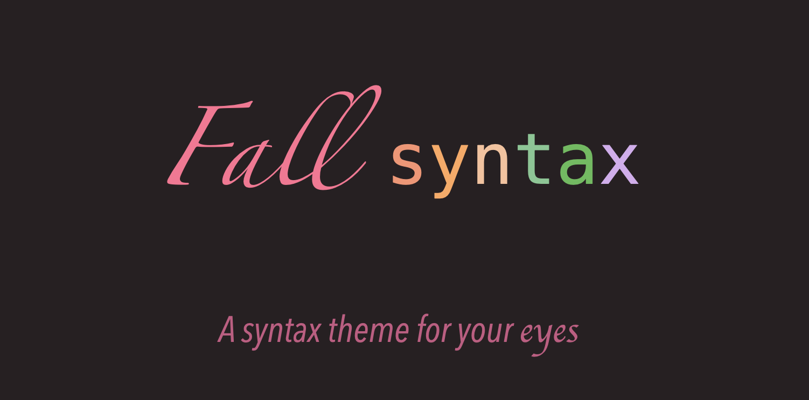

# Fall



Fall is a warm, dark color theme with three goals:

- Reduce blue light.\*
- Make code clear.
- Still look good.

<sub>\*Not clinically proven. Coding breaks are still recommended.</sub>

This repository holds the Fall palette and every port of it.

## Ports

| Port | Directory | Status |
| --- | --- | --- |
| [Atom / Pulsar](./ports/atom) | `ports/atom` | Published as [`fall-syntax`](https://web.pulsar-edit.dev/packages/fall-syntax) |
| [T3 Code](./ports/t3code) | `ports/t3code` | Generated from the palette |

Third-party ports:

- [Fall Syntax for VS Code](https://github.com/ThatXliner/fall-syntax-vscode) (unfinished)
- [Fall Syntax for Sublime Text](https://github.com/imnotril/fall-syntax-sublime-text)

## Palette

[`palette/fall.json`](./palette/fall.json) is the source of truth. Ports read colors from it instead of copying hex values.

| Color | Preview | Hex | Used for |
| --- | --- | --- | --- |
| Pink |  | `#FF7092` | Keywords, operators, tags |
| Orange |  | `#F99270` | Constants, numbers, escapes |
| Light Orange |  | `#FFB370` | Parameters, `self`, attributes |
| Peach |  | `#F9C19A` | Strings |
| Green |  | `#7EC892` | Definition keywords, links, TODOs |
| Purple |  | `#D6ABEE` | Function and class names |
| Maroon |  | `#C65882` | Comments |
| Foreground |  | `#E3DEDF` | Text |
| Punctuation |  | `#A29094` | Brackets, separators |
| Background |  | `#262022` | Background |

The palette's `syntax` section names the swatch for each role, and its `editor` section holds the derived UI colors (cursor, selection, gutter, diff colors).

## Development

Requires Node.js 20 or later. There are no dependencies to install.

```sh
npm run build   # regenerate every generated port
npm run check   # contrast, palette drift, and stale-output checks
```

`npm run check` fails when:

- a syntax color has a contrast ratio below 6:1 on the background,
- `ports/atom/styles/colors.less` disagrees with the palette, or
- a generated port is out of date.

### Adding a port

1. Create `ports/<name>/build.mjs`. Read colors with `loadPalette()` from `lib/palette.mjs`, and write output with `emit()` so `--check` works.
2. Add the script to `build` in `package.json` and to `GENERATED_PORTS` in `scripts/check.mjs`.
3. Commit the generated output so users can install it without building.

## License

MIT. See [LICENSE.md](./LICENSE.md).
