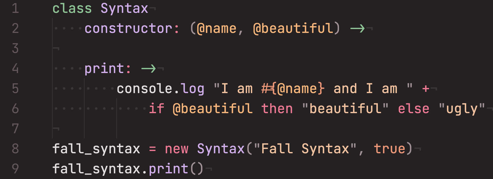

# Fall


Fall is a warm, dark color theme with three goals:

- Reduce blue light.\*
- Make code clear.
- Still look good.

<sub>\*Not clinically proven. Coding breaks are still recommended.</sub>

---



---

I set out to build a theme on top of those principles: something that minimizes the blue but still looks good. Why? [Blue light causes eyestrain and headaches](https://www.foreyes.com/blog/10-ways-how-blue-light-can-affect-you), which are a nuisance for the programmer (and the average computer user).

After about a month of color-picking, discussion, and color-tweaking, *Fall* was here. Every hue, every shade, was **meticulously hand-picked**, tested, and **checked against standards** such as the [WCAG 2.0 contrast ratio criterion](https://www.w3.org/TR/UNDERSTANDING-WCAG20/visual-audio-contrast-contrast.html). That check still runs on every commit.

Naturally, the colors are reddish and aesthetic, giving that **post-summer vibe**. 🍂

Besides warm colors, *Fall* features some nice **perks** such as

- Trivial parts of code (like comments and bracket pairs) are **faded**
- Consistent color semantics across languages (e.g. definitions of classes or functions are a green keyword followed by a purple name)
- **Increased contrast** on function/class definitions\*
- **No blue anywhere**, even where apps default to it (focus rings, update badges)

Enjoy!

<sub>\*Support may vary by language and port.</sub>

Fall started life as an Atom syntax theme ([`fall-syntax`](https://github.com/ThatXliner/fall-syntax)), originally forked from [Atomic-monokai-pro-syntax][monokai-pro-syntax]. Except now, it looks *nothing* like it. This repository holds the Fall palette and every port of it, so Fall can follow you to more places.

If you like it ❤️, **please star this repo**. That way, other people can find it too.

## Ports

| Port | Directory | Status |
| --- | --- | --- |
| [Atom / Pulsar](./ports/atom) | `ports/atom` | Published as [`fall-syntax`](https://web.pulsar-edit.dev/packages/fall-syntax) |
| [T3 Code](./ports/t3code) | `ports/t3code` | Generated from the palette |
| [VS Code](./ports/vscode) | `ports/vscode` | Generated from the palette. Not on the Marketplace yet |
| [Ghostty](./ports/ghostty) | `ports/ghostty` | Generated from the palette |
| [iTerm2](./ports/iterm2) | `ports/iterm2` | Generated from the palette |

Third-party ports:

- [Fall Syntax for Sublime Text](https://github.com/imnotril/fall-syntax-sublime-text)

## Palette

[`palette/fall.json`](./palette/fall.json) is the source of truth. Ports read colors from it instead of copying hex values.

| Color | Preview | Hex | Used for |
| --- | --- | --- | --- |
| Pink |  | `#FF7092` | Keywords, operators, tags |
| Orange |  | `#F99270` | Constants, numbers, escapes |
| Light Orange |  | `#FFB370` | Parameters, `self`, attributes |
| Peach |  | `#F9C19A` | Strings |
| Green |  | `#7EC892` | Definition keywords, links, TODOs |
| Purple |  | `#D6ABEE` | Function and class names |
| Maroon |  | `#C65882` | Comments |
| Foreground |  | `#E3DEDF` | Text |
| Punctuation |  | `#A29094` | Brackets, separators |
| Background |  | `#262022` | Background |

The palette's `syntax` section names the swatch for each role, its `editor` section holds the derived UI colors (cursor, selection, gutter, diff colors), and its `terminal` section holds the 16 ANSI colors. Fall has no blue, so the terminal's blue is Fall's purple.

## Development

Requires Node.js 20 or later. There are no dependencies to install.

```sh
npm run build   # regenerate every generated port
npm run check   # contrast, palette drift, and stale-output checks
```

`npm run check` fails when:

- a syntax color has a contrast ratio below 6:1 on the background,
- a terminal color other than black is below 4.5:1,
- `ports/atom/styles/colors.less` disagrees with the palette, or
- a generated port is out of date.

### Adding a port

1. Create `ports/<name>/build.mjs`. Read colors with `loadPalette()` from `lib/palette.mjs`, and write output with `emit()` so `--check` works. `npm run build` and `npm run check` find it automatically.
2. Commit the generated output so users can install it without building.

## FAQ

**I need this for another app.**

Check the [ports](#ports) above. If yours isn't there, **help port it!** See [Adding a port](#adding-a-port), and send a pull request.

**This looks like (insert some theme name).**

Welp. Great minds think alike!

**It's too reddish!**

Fair. I *highly recommend* @tterb's [Atomic-monokai-pro-syntax][monokai-pro-syntax] or @jackw01's [summer-night-syntax](https://github.com/jackw01/summer-night-syntax). [Nord](https://www.nordtheme.com/) is pretty good, too.

**How can I contribute?**

Either ~~complain about the colors~~ professionally critique the theme in the issues, or send a pull request with different colors or a new port. I'll merge it if I like it!

## Credits

- My ***epic*** friends [@KomodoKode](https://github.com/KomodoKode) and [@thatdevboyjun](https://github.com/thatdevboyjun) for feedback, suggestions, and critique!
- @tterb for the *amazing* [Atomic-monokai-pro-syntax][monokai-pro-syntax]
- The [City Lights theme](http://citylights.xyz/) for major inspiration
- Wimer Hazenberg and his [Monokai Pro theme](https://monokai.pro/), which heavily influenced the design. You can still see traces of Monokai hidden in the theme
- [Coolors.co](https://coolors.co/) for the *epic* palette generator (and color editor)

## License

MIT. See [LICENSE.md](./LICENSE.md).

[monokai-pro-syntax]: https://github.com/tterb/Atomic-Monokai-Pro-syntax
