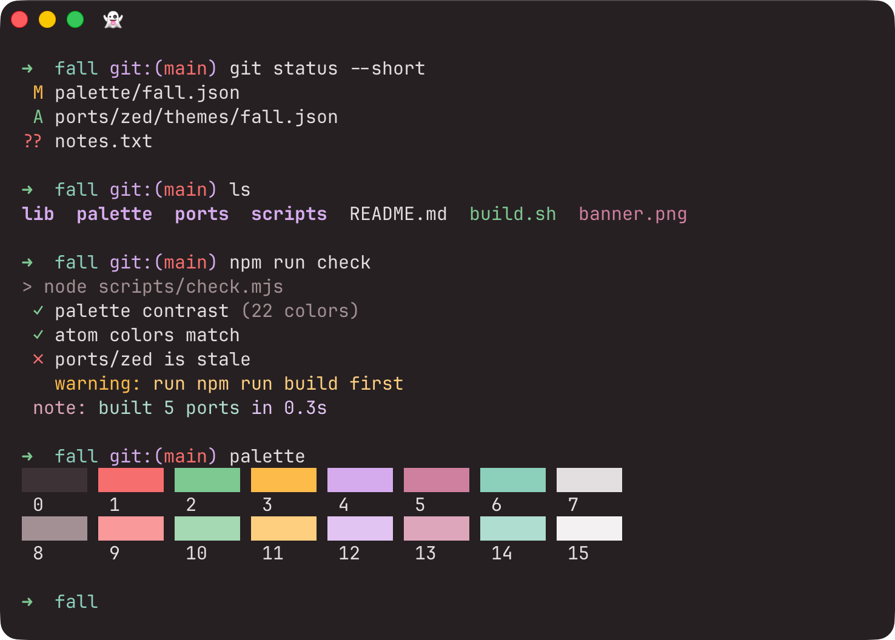

# Fall for Ghostty

A warm, low-blue terminal theme for [Ghostty](https://ghostty.org). 🍂



The ANSI palette uses Fall's colors and has no true blue: the blue slot is Fall's purple.

## Install

```sh
mkdir -p ~/.config/ghostty/themes
curl -fsSL https://raw.githubusercontent.com/ThatXliner/fall/main/ports/ghostty/Fall -o ~/.config/ghostty/themes/Fall
```

Then add this line to your Ghostty config and reload it (**Cmd+Shift+,** on macOS):

```
theme = Fall
```

## Build

`Fall` is generated from the [Fall palette](../../palette/fall.json). Do not edit it by hand. From the repository root, run `npm run build`.
