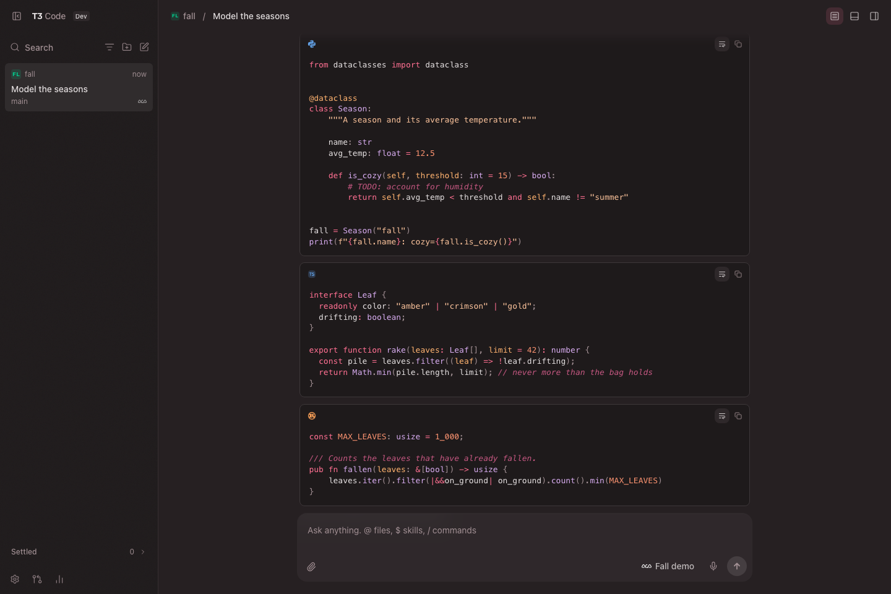
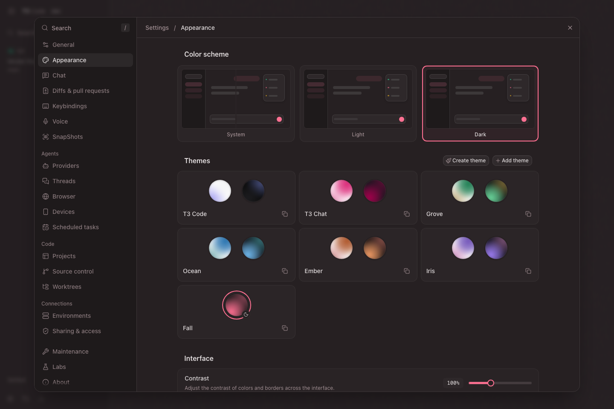

# Fall for T3 Code

A warm, low-blue theme for [T3 Code](https://t3.codes). The whole app takes on Fall's colors, and code blocks in chat get Fall's syntax highlighting. 🍂




## Install

```sh
curl -fsSL https://raw.githubusercontent.com/ThatXliner/fall/main/ports/t3code/fall.json -o fall.json
t3 theme set fall.json
```

T3 Code switches to Fall right away, in the desktop app and in the browser. To go back, pick another theme in the theme picker or run `t3 theme set t3-chat`.

No `t3` command? On web or desktop, open **Settings › Appearance**, choose **Create theme**, and import `fall.json`.

### Let your agent install it

Paste this into a T3 Code thread running in Full access:

> Install the Fall theme from https://github.com/ThatXliner/fall/tree/main/ports/t3code. Follow the "Instructions for agents" section of its README.

### Instructions for agents

1. Download `https://raw.githubusercontent.com/ThatXliner/fall/main/ports/t3code/fall.json`.
2. If the `t3` command is available, run `t3 theme set <path to fall.json>`.
3. Otherwise call the `t3_theme_set` tool with `themeId: "fall"` and the file's JSON as `theme`.
4. Do not edit the file. It is generated from the Fall palette.

## Requirements

- A T3 Code build with custom themes (November 2026 or later).
- Works in the desktop app and the browser. The phone app doesn't use themes.

## Notes

- Fall is dark only, so Appearance offers it for dark mode. Choose another theme for light mode.
- Fall avoids blue, so the spots T3 Code colors blue by default (focus rings, update badges) use pink and purple instead.
- The diff panel and file previews draw code where theme CSS can't reach, so code there keeps T3 Code's default syntax colors.
- T3 Code's default code theme gives class keywords and class names one color, so both appear purple. The Atom theme shows the keyword in green.

## How it works

`fall.json` is generated. Do not edit it by hand. From the repository root:

```sh
npm run build
```

`build.mjs` maps each of T3 Code's 61 color roles to a Fall color from [`palette/fall.json`](../../palette/fall.json).

T3 Code highlights code with a fixed Shiki theme, `pierre-dark`, and has no color roles for syntax tokens. The theme's custom CSS maps each `pierre-dark` token color to the Fall color for the same scopes, and makes comments italic as in the Atom theme. If T3 Code changes its code theme, update `PIERRE_DARK_TOKENS` in `build.mjs` and rebuild.
